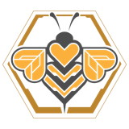
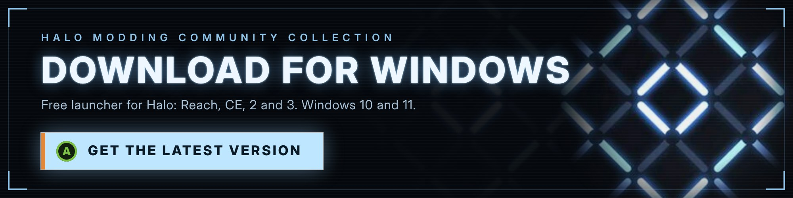
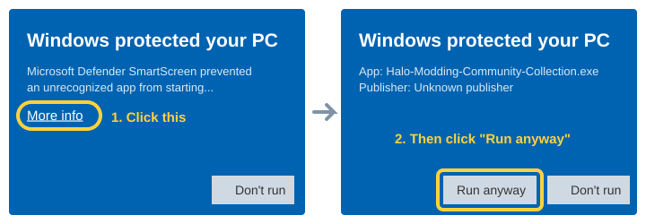
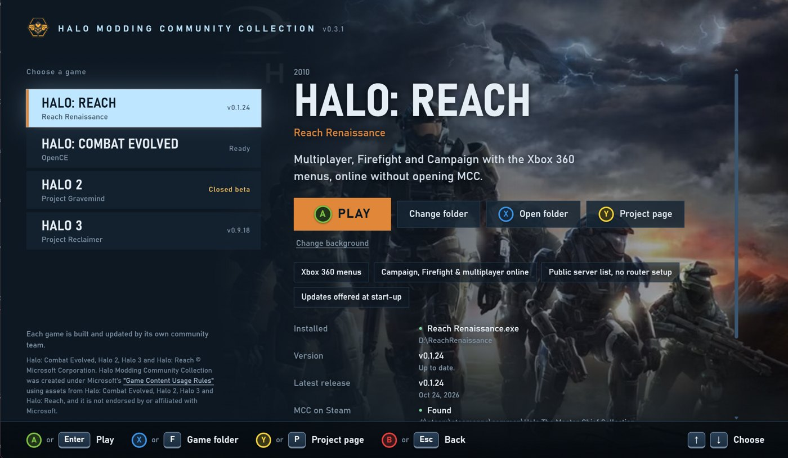

<p align="center">
  
</p>

<h1 align="center">Halo Modding Community Collection</h1>

<p align="center">
  <b>One launcher for the community Halo projects: Halo: Reach, Halo: Combat Evolved, Halo 2 and Halo 3.</b><br>
  Pick a game, press Play. Switch games any time, just like MCC.
</p>

<p align="center">
  <a href="../../releases/latest"></a>
  
  
</p>

## Download

<a href="../../releases/latest/download/Halo-Modding-Community-Collection.exe">
  
</a>

**[Download Halo-Modding-Community-Collection.exe](../../releases/latest/download/Halo-Modding-Community-Collection.exe)** (latest version, one file, no installer)

Or see every version on the [Releases page](../../releases).
Only download the launcher from this repository. Copies shared anywhere else could be tampered with.

---

## How to play (3 steps)

**1. Click the "Download for Windows" banner above** (or the blue link under it).
Your browser saves a file called `Halo-Modding-Community-Collection.exe`, usually in your **Downloads** folder.

**2. Double-click that file to open it.**
Tip: move it somewhere you'll find it again first, like your Desktop or a `Games` folder.

**3. If a blue box says "Windows protected your PC", click "More info", then "Run anyway".**
This shows up because the launcher is a free fan project and isn't signed by a paid certificate. It's normal and only happens the first time.

<p align="center">
  
</p>

**That's it.** The launcher opens and asks if you'd like a **desktop shortcut**. Say yes and you can open it from your desktop next time.
Pick a game on the left and press **PLAY**.
If a game isn't on your PC yet, press **INSTALL** and the launcher downloads it for you from that project's own page.

<p align="center">
  
</p>

---

## What you need

| Game | Made by | What you need on your PC |
|---|---|---|
| **Halo: Reach** | [Reach Renaissance](https://github.com/NETF1ix/reach-renaissance-releases) | Halo: The Master Chief Collection **on Steam**, with Halo: Reach installed |
| **Halo: Combat Evolved** | [OpenCE](https://github.com/OpenCommunityEdition/OpenCE) | **You must have your own copy of the Xbox ISO file for Halo: Combat Evolved.** (MCC's copy doesn't work for this one.) |
| **Halo 2** | [Project Gravemind](https://briroz1.github.io/project-gravemind/) | Halo: The Master Chief Collection **on Steam**, with Halo 2 installed. Download it from the [Project Gravemind Discord](https://discord.gg/7nAmnwnQqb) (join, then open the [download message](https://discord.com/channels/1558176132027785256/1562246771147673720/1562555204694450328)). |
| **Halo 3** | [Project Reclaimer](https://projectreclaimer.dev) | Halo: The Master Chief Collection **on Steam**, with Halo 3 installed |

- **Windows 10 or 11.** That's all the launcher itself needs.
- The **Microsoft Store / Game Pass** version of MCC doesn't work with these projects. You need the **Steam** version.
- You can play with a **mouse and keyboard** or an **Xbox controller**.

---

## Controls

| Controller | Keyboard | What it does |
|---|---|---|
| D-pad / stick | ↑ ↓ | Choose a game |
| **A** | **Enter** | Play (or Install) |
| **X** | **F** | Open the game's folder |
| **Y** | **P** | Open the game's project page |
| **B** | **Esc** | Back, or close the game that's running |

Picking another game while one is running asks first, then closes the first game and starts the new one.

---

## Questions

**I said no to the desktop shortcut. Can I still get one?**
Yes. Click **Add desktop shortcut** at the top right of the launcher.

**How do I update the launcher?**
From v0.3.4 on, the launcher tells you when a new version is out: click **Update now** in the bar at the top and it updates and restarts itself. Your settings stay. On v0.3.3 or older, click the DOWNLOAD button again and replace your old file with the new one. The games themselves keep updating on their own, the same way they always do.

**Is it safe?**
The launcher never includes or changes any game files, and it never asks for passwords or logins. It only finds the games you have, starts them, and downloads each game from that project's own GitHub page when you press Install. All of its code is in this repository for anyone to read, and each release lists a SHA-256 checksum so you can check your download. More in [SECURITY.md](SECURITY.md).

**My antivirus flagged it.**
Some antivirus programs are wary of new, unsigned programs. You can compare your file against `SHA256SUMS.txt` on the [Releases page](../../releases/latest), or check it on [VirusTotal](https://www.virustotal.com/). If it still worries you, [open an issue](../../issues/new/choose) and tell us which antivirus said what.

**I press Play, it says "Playing" for a second, then nothing happens.**
This is usually Windows Security's **Controlled folder access** (ransomware protection). It stops programs it doesn't know from saving to folders like Documents and Desktop, and some games quit when they can't save their settings. To allow the game:
1. Open **Windows Security** (search for it in the Start menu).
2. Click **Virus & threat protection**, then **Manage ransomware protection**.
3. Click **Allow an app through Controlled folder access**, then **Add an allowed app**.
4. Pick the game's program from **Recently blocked apps** (or use **Browse all apps** and choose it from the game's folder).
5. Press **Play** in the launcher again.

When a game updates to a new version, you may need to allow the new program the same way. If Controlled folder access is on, also keep the launcher and your games out of the Desktop and Documents folders (for example in `C:\Games`), so installs and launcher updates can save their files.

**It says a game is "Not set up", but I have it.**
Click **Change folder** (or **Choose folder**) on that game and point it at the folder where you unzipped it.

**How do I remove it?**
Delete the `.exe`. To also remove its settings, delete the folder `%APPDATA%\HaloCommunityCollection`.

**Can I change the background pictures?**
Yes. Click **Change background** under the Play button and pick any image.

**Something's broken or I have an idea.**
[Tell us here](../../issues/new/choose). No coding needed, it's just a form.

---

## Credits

Every game in the launcher is made and updated by its own community team. Go give them a star:

- **Halo: Reach:** [Reach Renaissance](https://github.com/NETF1ix/reach-renaissance-releases)
- **Halo: Combat Evolved:** [OpenCE](https://github.com/OpenCommunityEdition/OpenCE) ([Discord](https://discord.gg/9gqcHyr5km))
- **Halo 2:** [Project Gravemind](https://briroz1.github.io/project-gravemind/)
- **Halo 3:** [Project Reclaimer](https://projectreclaimer.dev)

This launcher doesn't replace any of them. It just puts them all in one place.

---

<details>
<summary><b>For modders and developers</b> (click to open)</summary>

### What's in this repository

| Path | What it is |
|---|---|
| `main.go` | Local server, game detection, launching and switching |
| `games.go` | The list of games: names, exe names, release files, requirements |
| `install.go` | Downloads a project's latest GitHub release, checks its SHA-256, unzips it |
| `art.go` | Background art: built-in, `art` folder, or the player's own pick |
| `platform_windows.go` | Windows bits: process list, folder pickers, the app window |
| `ui/index.html` | The whole menu (HTML, CSS and JavaScript in one file) |
| `ui/art/` | Built-in backgrounds |
| `brand/` | Icon and version info (`app.rc` builds `rsrc_windows_amd64.syso`) |

### How it works

The launcher is a single Go program. It starts a small web server on `127.0.0.1:47231` (only your own PC can reach it, and every request needs a per-session token) and shows the menu in an Edge app window. Settings are saved in `%APPDATA%\HaloCommunityCollection\config.json`.

### Build it yourself

You need [Go](https://go.dev/dl/) 1.24 or newer. From the repository folder:

```
GOOS=windows GOARCH=amd64 go build -trimpath -ldflags "-s -w -H windowsgui" -o Halo-Modding-Community-Collection.exe .
```

On Windows in PowerShell, set the variables first: `$env:GOOS="windows"; $env:GOARCH="amd64"`, then run `go build ...`.

Run the tests with `go test ./...`.

### Add a game

Add an entry to `games` in `games.go`: its folder names, how to find its exe, its GitHub releases repo and which release file to download. Then add its background to `ui/art/<id>.jpg`.

### Contributing

Bug reports, ideas and pull requests are welcome. See [CONTRIBUTING.md](CONTRIBUTING.md).

</details>

---

<sub>
Halo: Combat Evolved, Halo 2, Halo 3 and Halo: Reach © Microsoft Corporation. Halo Modding Community Collection was created under Microsoft's "<a href="https://www.xbox.com/en-US/developers/rules">Game Content Usage Rules</a>" using assets from Halo: Combat Evolved, Halo 2, Halo 3 and Halo: Reach, and it is not endorsed by or affiliated with Microsoft.
This launcher is free and will always be free.
</sub>
